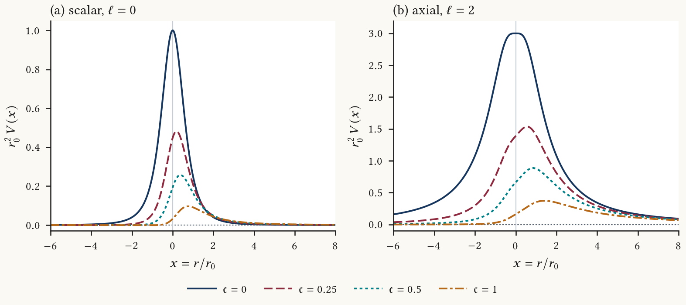

<!-- Author: Dr. Denys Dutykh (Mathematics Department, Khalifa University of Science and Technology, Abu Dhabi, UAE) -->

# EllisBronnikov: quasinormal modes and instabilities of massive Ellis–Bronnikov wormholes



The effective potentials of the scalar perturbations with ℓ = 0 (a) and of the axial perturbations with ℓ = 2 (b) of
the massive Ellis–Bronnikov wormhole, from equations (4) and (34) of the article, against x = r/r0 on both sides of the
throat x = 0, for the mass parameter c = 2M/r0 = 0, 0.25, 0.5 and 1. For c = 0, the massless Ellis wormhole, the
potentials are even in x; the mass lowers the barrier, by the factor e^(2f) = e^(−πc) at the throat, and pushes it to
the side x > 0.

EllisBronnikov holds the Maple and MATLAB material of a study of the quasinormal modes of the massive static phantom
wormhole of Ellis and Bronnikov, a solution of the Einstein equations sourced by a scalar field with the wrong sign of
its kinetic term, whose mass makes the two sides of the throat unequal. It computes the frequencies of the scalar
perturbations of the phantom field and of the axial gravitational perturbations, and their purely imaginary modes,
which signal an instability when they grow in time. Two Maple worksheets carry the derivation; two Maple procedures,
distilled from them with the coefficients written out, assemble in multiprecision arithmetic the matrices of a
Chebyshev collocation of the compactified radial equation, and a MATLAB script solves the resulting quadratic
eigenvalue problem with the Advanpix Multiprecision Computing Toolbox and draws the spectra of several resolutions
together. The method and the results are those of the article by Davide Batic and Denys Dutykh in the European
Physical Journal C (2025), cited below.

## The problem

The line element of the wormhole and the equation of a perturbation Z, with the time dependence e^(−iωt), are

```text
ds² = −e^f dt² + e^(−f) [ dr² + (r² + r0²) dΩ² ],      −∞ < r < +∞,      f(r) = (C/r0) [ arctan(r/r0) − π/2 ],

e^f d/dr( e^f dZ/dr ) + [ ω² − V(r) ] Z = 0,

V_S(r) = e^(2f) [ (ℓ(ℓ + 1) + 1)/(r² + r0²) − (2r − C)²/(4(r² + r0²)²) ]      scalar perturbations,
V_A(r) = e^(2f) [ (ℓ(ℓ + 1) − 3)/(r² + r0²) + 3(2r − C)²/(4(r² + r0²)²) ]      axial perturbations,
```

where r0 is the radius of the throat r = 0 and C = 2M; for M = 0 the wormhole is the massless Ellis (or Morris–Thorne)
wormhole, symmetric about the throat. Everything in the code is dimensionless: lengths are measured in units of r0,
x = r/r0, the frequency is Ω = ωr0, and the single parameter c = 2M/r0 is the ratio of the Schwarzschild radius of the
mass M to the radius of the throat (`c` in the code). The quasinormal modes are the solutions outgoing at both mouths,
x → ±∞; a mode with Im Ω > 0 grows in time and signals an instability. The article finds purely imaginary modes that
earlier studies had missed: scalar perturbations become unstable once c ⩾ 1, axial ones at smaller values of c, and
wormholes whose throat is much larger than the Schwarzschild radius stay stable.

The two worksheets carry out the same derivation in five stages: the equation `ODE2` is written in x (`ODE2x`); its
coefficients are expanded at x = ±∞ and the outgoing behaviour at both mouths, built from `arctan x` and an exponential
in Ω and c, is factored out of the solution, Z = A(x) Φ(x), which turns the radiation conditions into properties of
the ansatz; the map x = tan(πy/2) sends the whole line onto −1 < y < 1, with the mouths at y = ±1 and the throat at
y = 0 (`ODE3`); the coefficients are read off, rescaled by a power of (1 − y²) so that they are finite at the ends,
and split by powers of the frequency into nine functions L00 to L22, of which L12, L21 and L22 vanish; and their limits
at y = ±1 are checked to be finite. The regular part Φ is expanded in n Chebyshev polynomials and the
equation is collocated at the n roots y_i = cos((2i − 1)π/(2n)), which gives

```text
( M0 + i Ω M1 + Ω² M2 ) a = 0
```

with three real n × n matrices, whose 2n eigenvalues the script computes. No boundary row is needed: at y = ±1 the
coefficients of Φ′ and Φ″ in the frequency-independent part and the coefficient of Φ in the linear part vanish, while
L00, L11 and L20 stay finite, so that the equation itself reduces at each end to a relation between Φ and Φ′. The two
procedures differ in one line only, the coefficient L00, through which the potential enters; the angular momentum
enters both only through λ = L(L + 1).

## Quick start

The procedures write their matrices into the folder `data/` of the path they are given, which must exist:

```bash
git clone https://github.com/dutykh/EllisBronnikov.git
cd EllisBronnikov
mkdir -p data
```

In Maple, started in the folder of the repository, read the procedure of the sector and call it once per resolution;
here a perturbation with ℓ = 2 of the wormhole with c = 0.7:

```maple
read "matrixassembler-scalar.mpl":     # or "matrixassembler-axial.mpl"
MatrixAssembler(320, 200, 2, 0.7, "/absolute/path/to/EllisBronnikov"):
MatrixAssembler(320, 250, 2, 0.7, "/absolute/path/to/EllisBronnikov"):
MatrixAssembler(320, 300, 2, 0.7, "/absolute/path/to/EllisBronnikov"):
```

The arguments are the number of digits `d`, the number of Chebyshev modes `n` (the size of the matrices), the angular
momentum `L` (ℓ = 0 is admissible in the scalar sector; the axial sector starts at ℓ = 2), the mass parameter `c`, and
the path `p` of the folder that holds `data/`, without a trailing slash. Each call writes `data/M0_n.mat`,
`data/M1_n.mat` and `data/M2_n.mat` in the ASCII format of MATLAB. Since `chaseeigs.m` works with n digits, `d` must be
at least the largest n, with a margin. The assembly differentiates the Chebyshev expansion symbolically at every
collocation point, so its cost grows quickly with n and `d`: assembling once and iterating on the MATLAB side is the
economical order. The names of the files carry only n, so each pair of `L` and `c` is best kept in a folder of its own.

Then, in MATLAB, make the line `addpath('/path/to/advanpix/toolbox/')` of `chaseeigs.m` point to the Advanpix toolbox,
set its list of resolutions to the assembled ones (`list = [300, 250, 200]` as distributed), and run, from the folder
of the repository:

```matlab
chaseeigs
```

For each resolution n the script sets the precision to n digits (`mp.Digits(n)`), reads the three matrices with
`mp.read` (which keeps all their digits, where `load` would round them to double precision), solves
`polyeig(M0, mp('1i')*M1, M2)`, and finally draws all the spectra in the window −6 ⩽ Re ω ⩽ 6, −5 ⩽ Im ω ⩽ 1, one
marker per resolution (the cell array `Marks`; the script stops with an error if it has fewer entries than `list`).
In the script the name `L` is the number of resolutions, not the angular momentum, which is fixed in Maple. After the
run, the eigenvectors, the eigenvalues and the condition numbers of the largest resolution stay in the workspace as
`V0`, `e0` and `k0`. The article overlaps n = 350, 380 and 400 and computes with 400 digits.

## Reading the spectrum

A spectral discretisation of this non-self-adjoint problem returns the quasinormal frequencies mixed with artefacts of
the truncation. The converged modes sit at the same place for every resolution of the list, their markers falling on
one another, while the spurious ones drift as n changes, mostly in the outer parts of the window and deep in the lower
half-plane. A mode with Im ω > 0, which the window shows above the real axis, grows in time and signals an instability
for that pair of ℓ and c. The purely imaginary modes, the main finding of the article, lie on the axis Re ω = 0 and are
easily missed when only the oscillating branches are examined. Recomputing with a larger n, or with more digits, and
counting the digits of a candidate that do not change separates the physical modes, which gain digits, from the others.

## Contents

| File | Content |
|---|---|
| `SCALAR-PHANTOM-USING-ODE2.mw` | Maple worksheet: the derivation for scalar perturbations, from the equation to the nine coefficients and their limits at the ends |
| `AXIAL-PHANTOM-USING-ODE2.mw` | the same for axial perturbations |
| `matrixassembler-scalar.mpl`, `matrixassembler-axial.mpl` | the Maple procedures `MatrixAssembler(d, n, L, c, p)` of the two sectors |
| `chaseeigs.m` | the MATLAB script that solves the eigenvalue problem at several resolutions and draws the spectra |
| `docs/figures/` | the script `plot_readme_figure.py` that draws the figure of this page from the potentials, with the style file beside it |

## Requirements

Maple 18 or later, in which the worksheets are saved; the procedures use only `LinearAlgebra`, `ChebyshevT` and
`ExportMatrix`. MATLAB with the Advanpix Multiprecision Computing Toolbox (a commercial toolbox), whose `mp.Digits`,
`mp.read` and multiprecision `polyeig` the script uses: the article computes with 400 digits, double precision being
far too coarse for this problem. The figure of this page needs Python 3 with NumPy and Matplotlib, and is redrawn from
`docs/figures/` by `python3 plot_readme_figure.py`.

## How to cite

If you use this code, please cite the article:

D. Batic and D. Dutykh, Instability analysis of massive static phantom wormholes via the spectral method, The European
Physical Journal C 85, 144 (2025).

https://doi.org/10.1140/epjc/s10052-025-13867-x

```bibtex
@article{Batic2025,
  author = {Batic, Davide and Dutykh, Denys},
  title = {Instability Analysis of Massive Static Phantom Wormholes via the Spectral Method},
  journal = {The European Physical Journal C},
  year = 2025,
  month = feb,
  volume = {85},
  number = {2},
  pages = {144},
  doi = {10.1140/epjc/s10052-025-13867-x},
  eprint = {2502.05486},
  archiveprefix = {arXiv}
}
```

The button "Cite this repository" in the right-hand column of this page gives the same reference, read from
`CITATION.cff`. The article is open access, and a free copy is also on arXiv:

https://arxiv.org/abs/2502.05486

## Licence

GNU General Public License, version 3 (see `LICENSE`).

## Authors

Davide Batic and Denys Dutykh (Mathematics Department, Khalifa University of Science and Technology, Abu Dhabi). The
article is listed, with the other studies of quasinormal modes of the same group, in the
[Quasi-Normal Modes Hall of Fame](https://qnms.denys-dutykh.com/).

https://www.denys-dutykh.com/
